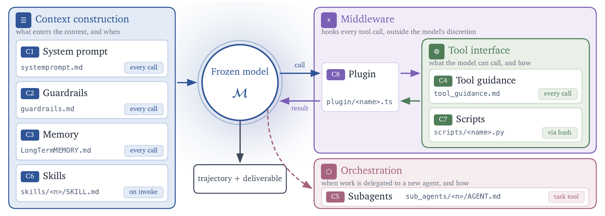

# DevEx Learning Harness: design and plan

A local, single-web-view harness that brings six open-source tools together. You use it to start a new production project, or to understand an existing codebase, while learning full-stack best practices at your own level.

> Status (2026-11-25): P0–P1 built, with parts of P2, P4 and P5 (launcher, proxy, discovery, events/SSE, budget, scope refusal, tracks, promotion, practice). The Go server also has a direct LLM chat (`internal/llm`) that isn't in the design below; its prompts now come from the context compiler (§12). Code Mode is served by `harness mcp` (§12). Not built yet: self-improvement. Claims not checked against the upstream code are marked **NEEDS VERIFICATION**.

---

## 1. Principles

1. **Orchestrate, don't absorb.** Each tool keeps its own UI, data and upgrade path. The harness owns exactly three things:
   - starting and stopping the tools
   - one web shell
   - one shared event log
2. **Install upstream, pinned. Never fork.** Tools are installed from their releases at pinned versions and run unmodified. This keeps upgrades cheap, and it keeps AGPL obligations (LearnHarness, ARTEX) from attaching to this repo.
3. **Integrate only through public surfaces:** CLIs, files the tools document, and HTTP APIs. Never through internals.
4. **Loopback only.** Every tool binds to `127.0.0.1`. Nothing is exposed to the network.
5. **One agent, many observers.** Claude Code (in the IDE or terminal) is the agent that does the work. The other tools teach it, review it, map it, watch it, price it, or attack what it built.
6. **Ponytail by default.** The least code that works cleanly, everywhere: in the harness itself, and in what it teaches ([principles.md](.claude/skills/go-tutor/principles.md)).

## 2. The six tools (checked 2026-11-24)

| Tab | Tool | Stack · license | How it runs | Address | Role in the harness |
|---|---|---|---|---|---|
| Learn | [LearnHarness](https://github.com/amosblomqvist/learnharness) | TS/Next.js + Electron · AGPL-3.0 | Desktop app. The source server runs with `npm run dev` | `:3000` (dev) | The teacher. It probes what you know, plans the minimal dependency tree, teaches one step at a time and checks each step, sets practice problems, and keeps a knowledge graph of propositions |
| Map | [Floorplan](https://github.com/haydenschmitty/floorplan) | Node 18+, zero dependencies · MIT | An agent skill writes `floorplan/`, and `serve.mjs` serves it | Random. Read from `floorplan/.cache/server.log` | The compass: a plain-English map. A blueprint (`plan.json`) for new projects, a from-code map for existing ones |
| Review | [Plannotator](https://github.com/backnotprop/plannotator) | TS binary · Apache-2.0 | One blocking session per review, plus one persistent Inbox | Random per session. Read from `plannotator sessions --json` | The gate. You annotate and approve plans, specs, diagrams and diffs. The Inbox holds decisions you answer later |
| Trail | [Agent Trail](https://github.com/camtrik/agent-trail) | TS/Next.js, Node 22+ · MIT | `npm i -g @camtrik/agent-trail` | `:3030` | **Debugging:** session replay, tool-call input and output, subagent trees, injected context. Session search API |
| Spend | [TokenTelemetry](https://github.com/VasiHemanth/tokentelemetry) | Python · MIT | `./start.sh` | `:13000` | **Spend:** per-project budgets and alerts, plan limits, per-model cost. The single source of truth for cost |
| Secure | [ARTEX](https://github.com/BaaRai/ARTEX) | Go + embedded Next.js + PostgreSQL · AGPL-3.0 | `docker compose up -d` | `:8787` | The auditor. It breaks a goal into intents, workers run real tools, and findings carry the captured HTTP evidence that proves them. It has scope rules, approval gates and budgets |

**Agent Trail and TokenTelemetry overlap.** Both index `~/.claude/projects` and both show tokens, cost and traces. The roles are split on purpose:
- Agent Trail answers *"what did the agent do, and why?"*
- TokenTelemetry answers *"what did it cost, and is it within budget?"*

The shell links each tab to its tool's distinctive views. Where the two disagree, TokenTelemetry is the cost of record.

## 3. Component diagram

```
                      Browser: http://harness.localhost:4400
 ┌────────────────────────────────────────────────────────────────────────────────┐
 │ Shell (web/): [Learn] [Map] [Review] [Trail] [Spend] [Secure]   status · level  │
 │   each tab = <iframe src="http://<tab>.localhost:4400">  + "open in window"     │
 │   timeline panel ← SSE /events                                                  │
 └──────────────┬─────────────────────────────────────────────────────────────────┘
                │ one port, routed by subdomain (Host header)
 ┌──────────────▼─────────────────── cmd/harness (Go, stdlib) ────────────────────┐
 │ supervisor   start/stop/health/restart per harness.json, reverse dependency stop│
 │ proxy        httputil.ReverseProxy per subdomain, loopback-only header policy   │
 │ discovery    random ports: floorplan/.cache/server.log, plannotator sessions    │
 │ events       tail .harness/events.jsonl → SSE; append from hooks and gates      │
 │ doctor       runtimes, PATH, versions, ports free                               │
 └──┬────────┬──────────┬──────────────┬─────────────┬──────────────┬─────────────┘
    │        │          │              │             │              │
 LearnHarness Floorplan  Plannotator    Agent Trail   TokenTelemetry ARTEX (Docker)
  :3000      serve.mjs   Inbox+sessions :3030         :13000         :8787 + Postgres
    │        │  ▲         │  ▲            ▲             ▲              │ scope = loopback
    │        │  │writes   │  │gate JSON   │reads        │reads         │ attacks
    ▼        ▼  │         ▼  │            │             │              ▼
 ┌────────────────────────────────────────────────────────────────────────────────┐
 │ Local codebase (this repo)   floorplan/*.json  rules/*.md                       │
 │ Claude Code (IDE / terminal) ── hooks ──► .harness/events.jsonl                 │
 │ ~/.claude/projects/**/*.jsonl  (session logs, read-only to Trail and Spend)     │
 │ Todo/app under test on :8080  ◄──────────────────────────────── ARTEX           │
 └────────────────────────────────────────────────────────────────────────────────┘
```

**There are three integration paths, and nothing else:**

| Path | Example |
|---|---|
| Files the tools document | `floorplan/plan.json`, `recent-work.json`, annotations; Plannotator `--result-file` |
| The tools' own HTTP APIs and CLIs | Agent Trail `GET /api/v1/sessions/search`; `plannotator sessions --json`; ARTEX `/api/tasks` |
| The harness event log | `.harness/events.jsonl`, one JSON line per event, keyed by `session_id` + `git_sha` + `step` |

## 4. Repository layout

```
harness.json                  # tools, pinned versions, ports, profiles, level, budgets
cmd/harness/main.go           # `harness up|down|status|doctor|level`
internal/
  supervisor/                 # exec.CommandContext, health checks with backoff, dependency order
  proxy/                      # subdomain → upstream, header policy, websocket passthrough
  discovery/                  # read random ports from each tool's own state
  events/                     # append-only JSONL + SSE fan-out
  doctor/                     # preflight checks
web/                          # static shell: index.html, shell.js, shell.css (no framework)
rules/                        # ponytail-based rule packs (see §8)
  go.md typescript.md python.md rust.md web.md native.md api-design.md architecture.md
tracks/
  beginner.json intermediate.json advanced.json   # tabs shown, agent mode, gates required
.claude/skills/
  go-tutor/                   # exists: six-stage tutor loop and principles.md
  harness-cycle/              # the end-to-end cycle in §6, language-generic
  rule-gate/                  # annotate a plan or diff against rules/*.md with rule ids
floorplan/  docs/             # exist
.harness/                     # runtime, git-ignored: pids, logs/, events.jsonl, ports.json
```

**What makes it iterable:**
- New tools are a `harness.json` entry, not code.
- New languages and frameworks are a rule pack, not code.
- New levels are a `tracks/*.json` file.

The Go code changes only when a new *kind* of integration is needed.

## 5. Orchestration across runtimes (Node, Python, Go, Docker)

The launcher is about 400–600 lines of stdlib Go.

- **Start.**
  - Read `harness.json`, filter tools by the selected profile, then sort them by `depends_on`. A cycle is an error.
  - For each tool, run `exec.CommandContext(ctx, cmd...)` with its `cwd` and `env`. stdout and stderr go to `.harness/logs/<id>.log`.
  - Each tool runs in its own process group, so a stop signal reaches its children (`npm` → `next`).
- **Health.**
  - Poll the tool's `health` URL with exponential backoff up to `timeout`. A tool that isn't ready marks the tab red; the other tools carry on.
- **Session-shaped tools** (Floorplan, Plannotator).
  - The harness does **not** own their lifetime. They're started by the agent when it needs them (a map update, a review).
  - `discovery` re-reads their addresses (`floorplan/.cache/server.log` holds `Floorplan: http://127.0.0.1:<port>`, and `plannotator sessions --json` gives a `url` per session) and re-points the proxy route.
  - The Review tab shows the Inbox, plus a list of live review sessions.
- **Stop.** On SIGINT/SIGTERM:
  - cancel the root context
  - send SIGTERM to each process group in reverse start order
  - wait up to a grace period, then SIGKILL
  - run `docker compose stop` for ARTEX
- **Doctor.**
  - Checks: Node ≥ 22, Python ≥ 3.10, Docker running (`security` profile only), `claude` and `plannotator` on PATH, pinned versions installed, ports free.
  - Each failure gets a one-line fix.
- **Profiles** keep the footprint matched to the level:

  | Profile | Tools | Runtimes needed |
  |---|---|---|
  | `core` | Floorplan, Plannotator, LearnHarness | Node, plannotator binary |
  | `observe` | core + Agent Trail + TokenTelemetry | + Node 22, Python |
  | `security` | observe + ARTEX | + Docker |

## 6. Configuration snippets

### `harness.json`

```json
{
  "$schema": "harness@1",
  "level": "beginner",
  "profile": "core",
  "listen": "127.0.0.1:4400",
  "project": { "root": ".", "app_ports": [8080] },
  "tools": [
    {
      "id": "learn", "tab": "Learn", "profile": "core",
      "version": "0.7.0",
      "command": ["open", "-a", "LearnHarness"],
      "health": "http://127.0.0.1:3000/",
      "note": "desktop app; web mode via its source server is NEEDS VERIFICATION"
    },
    {
      "id": "map", "tab": "Map", "profile": "core",
      "managed": false,
      "port_from": { "file": "floorplan/.cache/server.log", "regex": "Floorplan: (http://\\S+)" }
    },
    {
      "id": "review", "tab": "Review", "profile": "core",
      "command": ["plannotator", "inbox", "--background"],
      "port_from": { "command": ["plannotator", "inbox", "status", "--json"], "json_path": "url" },
      "sessions_from": ["plannotator", "sessions", "--json"]
    },
    {
      "id": "trail", "tab": "Trail", "profile": "observe",
      "version": "@camtrik/agent-trail@<pin>",
      "command": ["agent-trail"],
      "env": { "CLAUDE_PROJECTS_DIR": "${HOME}/.claude/projects" },
      "health": "http://127.0.0.1:3030/"
    },
    {
      "id": "spend", "tab": "Spend", "profile": "observe",
      "cwd": "${HARNESS_TOOLS}/tokentelemetry",
      "command": ["./start.sh"],
      "env": { "TT_ANONYMOUS_STATS": "0" },
      "health": "http://127.0.0.1:13000/",
      "note": "the telemetry-off key name is NEEDS VERIFICATION; it is on by default upstream"
    },
    {
      "id": "secure", "tab": "Secure", "profile": "security",
      "cwd": "${HARNESS_TOOLS}/ARTEX",
      "command": ["docker", "compose", "up"],
      "stop": ["docker", "compose", "stop"],
      "health": "http://127.0.0.1:8787/",
      "depends_on": ["docker"],
      "scope": { "allow": ["127.0.0.1", "localhost"], "ports": "${project.app_ports}", "deny": ["*"] }
    }
  ],
  "budgets": { "per_feature_usd": 2.0, "alert_at": [0.8, 1.0] },
  "rules": ["rules/go.md", "rules/web.md", "rules/api-design.md", "rules/architecture.md"]
}
```

`port_from` for the Inbox: whether `plannotator inbox status --json` prints the URL is **NEEDS VERIFICATION**. If it doesn't, the fallback is to parse the address that `plannotator inbox --open` prints. ARTEX `scope` is the harness's *intent*. How it maps onto ARTEX's own scope and deny rules (set in its UI or through `/api/tasks`) is **NEEDS VERIFICATION**, and the harness refuses to start an ARTEX task until the mapping is confirmed.

### Claude Code hooks → event log (`.claude/settings.json`)

```json
{
  "hooks": {
    "PostToolUse": [
      { "matcher": "Edit|Write|Bash",
        "hooks": [{ "type": "command",
          "command": "jq -c --arg sha \"$(git rev-parse --short HEAD 2>/dev/null)\" '{t:(now|todate), ev:.hook_event_name, session:.session_id, tool:.tool_name, sha:$sha}' >> .harness/events.jsonl" }] }
    ],
    "Stop": [
      { "hooks": [{ "type": "command",
          "command": "jq -c '{t:(now|todate), ev:\"stop\", session:.session_id}' >> .harness/events.jsonl" }] }
    ]
  }
}
```

Plan review needs no extra hook: Plannotator's own ExitPlanMode hook (installed with Plannotator) opens every agent plan for review.

### Quickstart

```bash
go run ./cmd/harness doctor
go run ./cmd/harness up --profile core      # opens http://harness.localhost:4400
go run ./cmd/harness level intermediate     # switches track + profile, restarts what changed
go run ./cmd/harness down
```

## 7. The end-to-end cycle: "Build a Todo app"

The `harness-cycle` skill drives this, and each step appends an event. The shell's timeline shows them in order.

| # | Tab | You do | The agent does | Artifact / event |
|---|---|---|---|---|
| 0 | Shell | `harness up`, then type the goal "Build a Todo app (web + API)" | — | `goal` event |
| 1 | **Learn** | Answer the probe questions and think out loud | LearnHarness brackets what you know and plans the minimal path (Mermaid DAG) | Lesson plan; knowledge graph updated |
| 2 | **Map** | Read the map and ask questions on it | Writes a PRD, then a Floorplan **blueprint** (`plan.json`): files, endpoints, which screen calls what, who may use each endpoint. For an existing repo, a from-code map comes first | `floorplan/plan.json`; design review lists open questions |
| 3 | **Review** | Annotate and approve | Plan mode, then Plannotator opens the plan; `rule-gate` pre-annotates violations with rule ids (`API-3: unversioned public route`) | `decision: approved / annotated` (`--result-file`) |
| 4 | **Trail** | Watch the agent live and replay anything surprising | Builds one card at a time. Beginners use the go-tutor loop (you write the code); intermediate and above, the agent writes and you review | Tool calls and subagent tree; Floorplan Recent work turns cards green |
| 5 | **Review** | Review the diff | `plannotator review --gate` plus the language gate (`go vet && go test -race`, `tsc --noEmit && vitest`, …) | `gate` event (PASS/FAIL + output path) |
| 6 | **Spend** | Check the cost per feature against budget | — | Budget alert at 80% / 100%; `cost` event |
| 7 | **Secure** | Approve each intrusive step | An ARTEX task, "audit the Todo API on :8080", scoped to loopback, with approval gates on. Findings carry the request and response | Findings become Plannotator Inbox items, then fix tasks |
| 8 | **Learn** | Practice session | LearnHarness poses varied problems from what was taught, plus each rule you broke in steps 3–7 | Practice outcome |

The loop repeats per feature. A feature counts as done when its card is built on the map, its last `gate` event is PASS, it's within budget, and it has no open High findings.

## 8. Teaching and enforcing best practices

### Rule packs (`rules/*.md`)

Every rule pack extends [principles.md](.claude/skills/go-tutor/principles.md) and uses the same shape:

```
### API-3  Public routes are versioned
Rule:     /v1/... for every route a client outside this repo calls.
Prevents: breaking mobile clients you can't force-update.
Detect:   Floorplan endpoint list; rule-gate on plans; route lint in CI.
Teach:    LearnHarness goal "why native clients pin API versions".
```

| Pack | Covers (examples) |
|---|---|
| `go.md` | ctx first, `%w` wrapping, consumer-side interfaces, goroutine ownership, `-race` |
| `typescript.md` | `strict`, no `any` at boundaries, schema validation (zod or similar) at I/O edges |
| `python.md` | type hints + mypy at boundaries, no mutable defaults, `ruff` |
| `rust.md` | `Result` over panics, ownership at API edges, `clippy -D warnings` |
| `web.md` | Server state vs client state (no server data copied into a client store), URL as state, accessibility, CWV budgets |
| `native.md` | Offline-first data, versioned APIs, platform idioms (SwiftUI, Compose, Flutter, React Native), secure storage for tokens |
| `api-design.md` | REST resources and status codes, or GraphQL schema-first; pagination; idempotency keys on writes; error envelope |
| `architecture.md` | **Modular monolith first.** Split into a service only at a proven seam (independent scaling, team or deploy cadence). Dependencies point inward. Contracts are versioned |

### Where each rule is enforced

| Point | Tool | Mechanism | Strength |
|---|---|---|---|
| Plan | Plannotator + `rule-gate` | The agent's plan opens in Plannotator with rule-id annotations. You approve, or annotate to send it back | **Advisory.** No tool "rejects" a plan by itself; you decide, with machine pre-annotation |
| Structure | Floorplan | Blueprint design review (open endpoints, unconnected pieces, undecided auth) and Health check on code | Advisory, visible on the map |
| Diff | Plannotator review + language gate | `--gate --json --require-approval` gives an exit code; lint and tests must pass | **Blocking** for the cycle: no green card without PASS |
| Idiom | LearnHarness | Every rule broken in a cycle becomes a session goal or practice problem | Teaching |
| Security | ARTEX | Findings with evidence; High findings block "done" | Blocking for "done" |
| Cost | TokenTelemetry | Budgets are observational upstream; the harness turns a 100% alert into a cycle warning | Advisory |

## 9. Adapting to skill level

The level lives in `harness.json`. It's **promoted on evidence, not time:** a run of PASS `gate` events with no hint-ladder rung above 2 (beginner → intermediate), and no High ARTEX findings across two features (intermediate → advanced).

| | Beginner | Intermediate | Advanced |
|---|---|---|---|
| Profile | `core` | `observe` | `security` |
| Primary tabs | **Map** (plain-English audience), **Learn** step-by-step | **Review** (AI architecture), **Spend** | **Trail** (subagent debugging), **Secure** |
| Hidden tabs | Trail, Spend, Secure | Secure | none |
| Who writes code | **You.** Tutor mode with the full hint ladder ([go-tutor](.claude/skills/go-tutor/SKILL.md), language-generic) | The agent writes; you review every plan and diff | The agent, autonomously, with gates |
| Ruleset | Ponytail first: the least code that works; one concept per step; explains *why* for every rule | Full rule packs; focus on boundaries and architecture | Full packs plus security and performance; you write new rules |
| Gates required | Language gate + map update | + plan approval + budget per feature | + ARTEX audit + replay review of any failed delegation |
| Floorplan audience | `everyone` | `developers` | `developers` |
| Typical exercise | Build one card: model → repository → controller → handler | Reject an over-engineered AI plan; cut a feature's token cost by 30% using Spend and Trail | Debug a subagent that lost context (Trail injected-context view); pentest your own API |

## 10. The hardest problems (critique)

1. **One web view across six origins.**
   - Tools can send `X-Frame-Options` or a CSP `frame-ancestors` that blocks iframes. Next.js apps use absolute `/_next/` paths that break under path-prefix proxying. Cookies are origin-scoped.
   - **Approach:** proxy by subdomain (`trail.localhost:4400`), so each app keeps its root path. Strip frame-blocking headers **only** for loopback upstreams. Keep an "open in window" fallback on every tab.
   - **NEEDS VERIFICATION:** each tool's actual headers; Safari's `*.localhost` resolution (Chrome and Firefox resolve it to loopback); websocket and SSE passthrough for live views.
2. **Some tools are sessions, not servers.**
   - Plannotator reviews block until a decision, on random ports. Floorplan is redrawn by an agent skill. The harness has to *discover* them, not own them.
   - Racing a tool's own lifecycle (killing a review mid-decision) loses the decision. So the harness never stops what it didn't start.
3. **LearnHarness is a desktop app.**
   - Its web server path exists for development, but whether it's supported is **NEEDS VERIFICATION**.
   - Its Claude Code provider runs in an empty temporary directory with Claude Code's own tools turned off. So it can't read your repo through Claude Code, only through its own read-only file tools, under its file-access policy (**NEEDS VERIFICATION** that those can reach this repo).
   - Plan B: keep it as a separate window that the Learn tab launches, and connect it later with a LearnHarness plugin (§11, P4).
4. **Four runtimes plus Docker.** Node 18/22, Python, Go and Docker raise the cost of entry and drift over time. Profiles, pinned versions and `doctor` reduce this; nothing removes it. A beginner needs only `core`.
5. **Duplicate indexing.** Agent Trail and TokenTelemetry both parse the same `~/.claude/projects` logs. That costs twice the CPU and disk, and their cost estimates can disagree. Their roles are split and TokenTelemetry is the cost of record. Revisit if one adds the other's features.
6. **No shared identity.** Each tool has its own IDs. Correlation runs through `.harness/events.jsonl`, keyed by Claude Code `session_id` + `git_sha` + harness `step`. Joining *into* a tool's UI (deep-linking the Trail session for a `gate` event) depends on each tool's URL scheme (**NEEDS VERIFICATION** for Agent Trail and TokenTelemetry).
7. **Running an offensive tool locally.**
   - ARTEX runs real attack tools. Scope must be locked to loopback and the app's own ports, approval gates stay on, and it's never pointed at a third party. The `security` profile is opt-in and prints the scope before every task.
   - AGPL: run ARTEX unmodified and don't vendor it.
   - Its `mcphttp/` folder suggests an MCP endpoint that could let the agent request audits (**NEEDS VERIFICATION**). Even if it exists, don't let the coding agent start attacks without your approval.
8. **Privacy.**
   - TokenTelemetry's anonymous usage stats are **on by default** upstream, and the harness must turn them off.
   - LearnHarness and ARTEX send context to the model providers you configure.
   - "Local" means local storage, not offline processing. Say so in the shell.
9. **Upstream churn.** Six fast-moving repos (several had commits this week). Integrate through documented CLIs, files and APIs only. Pin versions. Run `doctor` against the pins. Keep a contract test per integration (e.g. "`plannotator sessions --json` returns objects with `url`").
10. **Cognitive load.** Six tabs is a cockpit, and a beginner needs a single window. Hide tabs per level, and make the timeline the default view ("what just happened"), not the tabs.
11. **Enforcement is soft.** Most gates are human-approved annotations, not hard checks. That's deliberate (judgment stays with you), but you can rubber-stamp. Mitigation: blocking gates only where a machine can decide (tests, lint, ARTEX High findings), and `gate` events that record who approved what.

## 11. Plan

Each phase ends with a gate command that must pass, recorded as a `gate` event in `.harness/events.jsonl`.

| Phase | Build | Gate |
|---|---|---|
| **P0 Launcher** | `harness.json` schema + validation, `doctor`, `up/down/status` for the `core` profile, a shell of links plus health dots | `go vet ./... && go test -race ./... && go run ./cmd/harness doctor` |
| **P1 One view** | Subdomain reverse proxy, iframe tabs, discovery of random ports, `.harness/events.jsonl` + SSE timeline, Claude Code hooks | Proxy test with an `httptest` upstream that sends `X-Frame-Options`; SSE client test; manual check in 3 browsers |
| **P2 Observe + rules** | The `observe` profile (Agent Trail, TokenTelemetry), `rule-gate` skill, rule packs for Go, TS, web, api-design and architecture, `harness-cycle` skill, budgets in the timeline | One full Todo cycle (§7, steps 1–6) recorded in the timeline |
| **P3 Security** | The `security` profile, ARTEX via Docker, scope mapping and refusal, findings sent to the Plannotator Inbox | ARTEX audit of the local Todo API with scope printed and approvals logged; zero requests outside loopback (checked from ARTEX's traffic recording) |
| **P4 Deep learning** | A LearnHarness plugin: Floorplan `graph.json` as a view, plus practice problems whose `process` step runs real tests in the repo; rule packs for Python, Rust and native | A practice problem that fails on a wrong solution and passes on a right one, end to end |
| **P5 Levels** | `tracks/*.json`, evidence-based promotion, per-level tab hiding | A beginner track run end to end by someone who isn't the author |

**Out of scope for now:** multi-user or remote access, a cloud mode, replacing any tool's UI, and a database of our own. Add them only when a phase above needs them.

## 12. Next (v1): harness as data, Code Mode, self-improvement

This direction ports [harness2](https://github.com/google-research/harness2)'s idea: improve the *harness* (prompts, guardrails, memory, tool guidance, subagents, skills, scripts, plugins) while the model stays fixed.

| Phase | Build | Gate |
|---|---|---|
| **V0 Foundations** | git repo (so `git_sha` is set); Origin guard on API writes (CSRF); IPv6 host parsing; current model IDs | `go vet ./... && go test -race ./...` (done) |
| **V1 Context compiler** | `context/system/*.md` (base, mode, mode.level) replaced `llm.SystemPrompt`. `internal/compiler` adds principles, the rule index (id + Rule: line), track, guardrails and skill index to a cacheable prefix, plus the last 5 lessons per domain (`context/memory/lessons/<domain>.jsonl`) as a suffix. The version is a 12-hex hash. A project's `context/` overrides the embedded defaults. Every harness model call logs `llm-usage`, and also a `cost` event when prices are set in `.harness/llm.json`. `harness context compile [--out file]` lets Claude Code opt in via `@file`. Guardrails still live in `harness.json` | Golden + override + lessons tests; stable hash (done) |
| **V2 Code Mode** | `harness mcp` (stdio MCP, registered in `.mcp.json`) exposes `search` / `describe` / `execute`. `internal/codemode` runs the model's async JS in a fresh goja VM per call with only connector globals: no fetch, require, process, timers or fs. Limits: 30 s, 50 calls, 1024 stack frames, about 6k-token result cap. The read-only connectors are `events.recent`, `budget.status`, `floorplan.plan`, `review.sessions`, `trail.search`, `practice.list/run` and `context.compile`. Nothing can write gate, cost or finding events, so the judge can't be fooled. `save_as` writes snippets to `context/scripts/` for `codemode.run`. Tool guidance is `context/tools/guidance.md`. Each execute logs a `codemode` event. **Deferred:** approval pause and replay, because no approval-gated connector exists until ARTEX's `secure.task` mapping is verified | Sandbox, limits, snippets and MCP protocol tests (done). The A/B token gate (≥25% fewer input tokens) is still open and needs real sessions |
| **V3 Judge + evals** | `evals/` (practice problems plus recorded cycles), seeded train/test split; a deterministic score from gate, finding, cost and rework events. Failed evals stay unscored | Same events give the same score |
| **V4 Improve loop** | propose K edits to `context/`, probe each in a worktree, compose the winners, re-check on the test split. **A human adopts it in Plannotator, never automatically. Guardrails are human-edit only.** Lessons go to memory with evidence; versions are git tags with rollback | One adopted improvement, end to end; rollback restores the previous hash |
